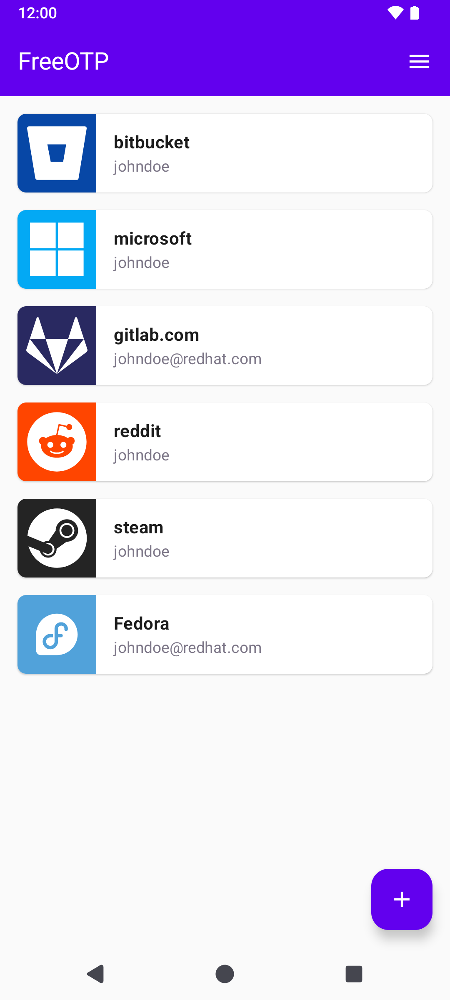
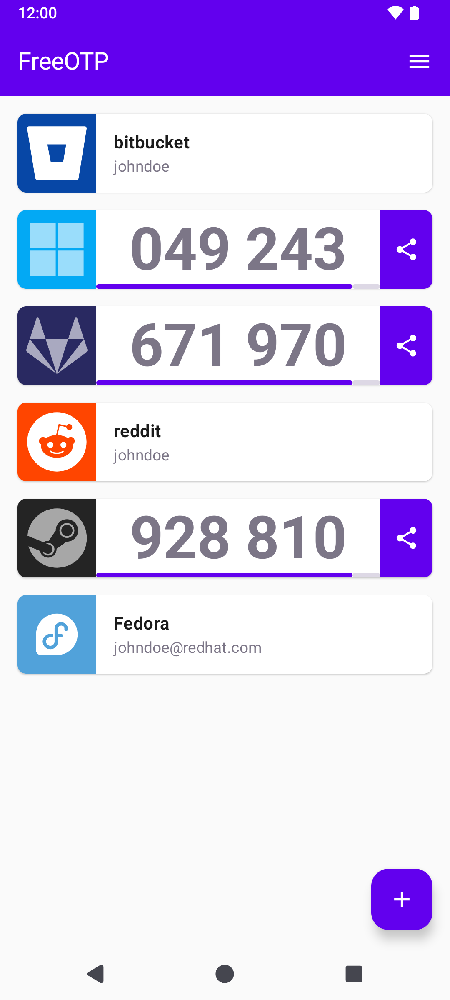
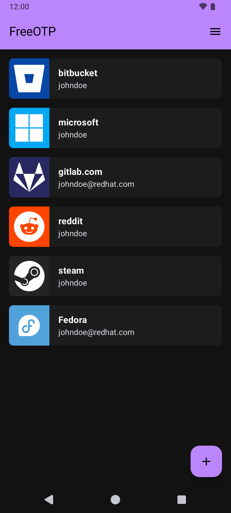
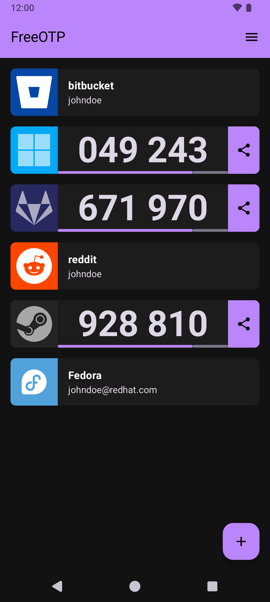

# FreeOTP

FreeOTP is a two-factor authentication app for Android that generates one-time passwords. Tokens
are added by scanning a QR code or entering them by hand.

It implements the open standards:

* HOTP (HMAC-Based One-Time Password Algorithm) [RFC 4226](https://www.ietf.org/rfc/rfc4226.txt)
* TOTP (Time-Based One-Time Password Algorithm) [RFC 6238](https://www.ietf.org/rfc/rfc6238.txt)

so it works with any server that implements them.

## Screenshots

 &nbsp; &nbsp; &nbsp;

## Building

```sh
./gradlew assembleDebug            # debug APK (applicationId with a ".debug" suffix)
./gradlew build -x lint            # what CI runs
./gradlew connectedAndroidTest     # instrumented tests, need an emulator or device
```

Requires JDK 17.

## Documentation

* [URI.md](URI.md): the supported `otpauth://` token URI format
* [BACKUP.md](BACKUP.md): how backup and restore work
* [BRANDING.md](BRANDING.md): how token icons and colors are chosen, and how to add an issuer
* [MIGRATION.md](MIGRATION.md): the ongoing migration to Kotlin and Jetpack Compose

## Permissions

| Permission | Usage | Required | Permission type |
|------------|-------|----------|-----------------|
| Camera | Scanning QR codes | No | Dangerous |
| Internet | Loading token images from the `image` URI parameter | No | Normal |
| Vibrate | Feedback when a QR code is recognized | No | Normal |
| Use fingerprint | Unlocking tokens that require authentication (`lock`) | No | Normal |
| Bluetooth, Bluetooth admin, Bluetooth scan/connect, coarse location | Sharing a code with a nearby device over Bluetooth LE | No | Dangerous (scan/connect, location) |

## License

Apache License 2.0, see [COPYING](COPYING).
